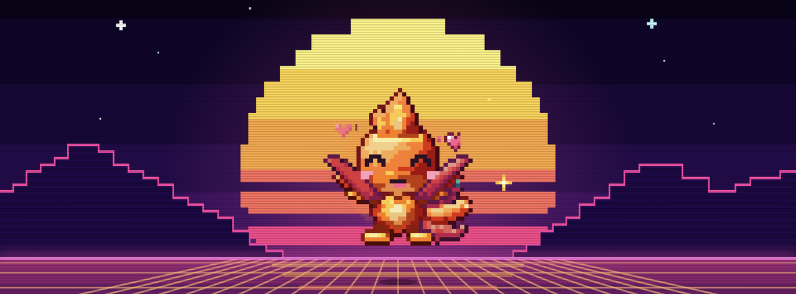
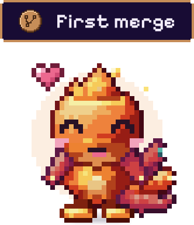
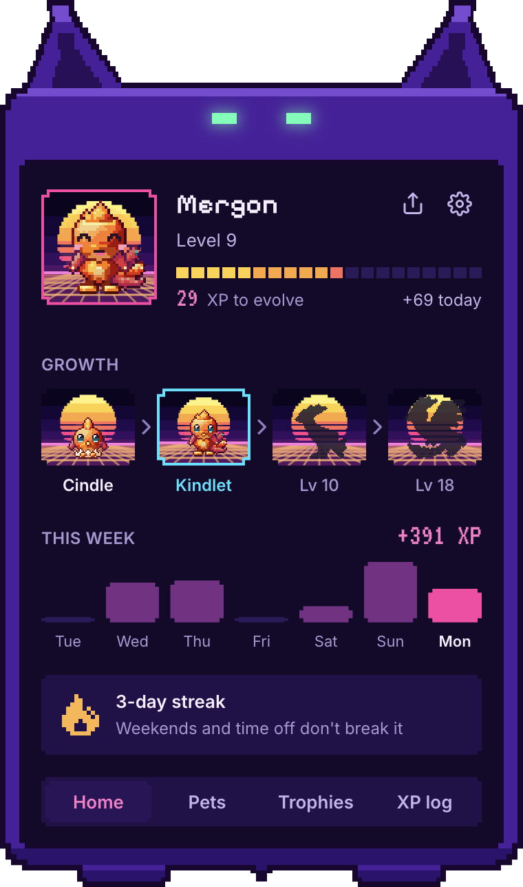
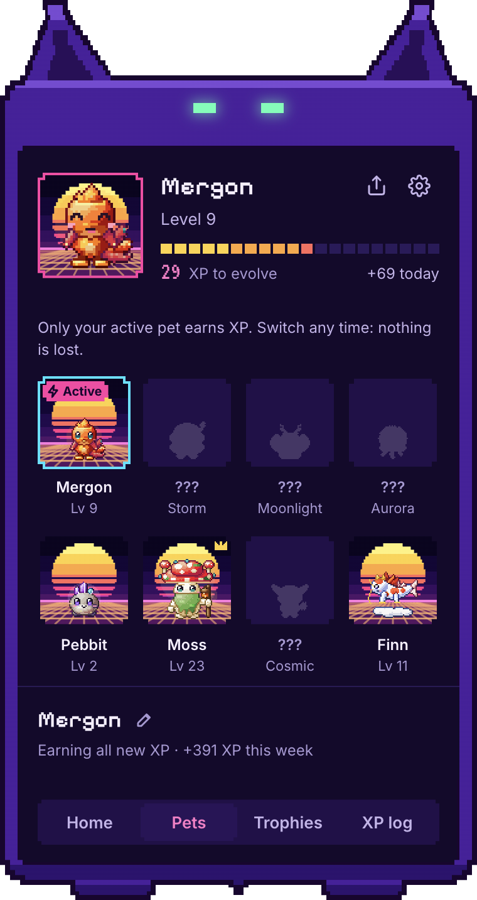
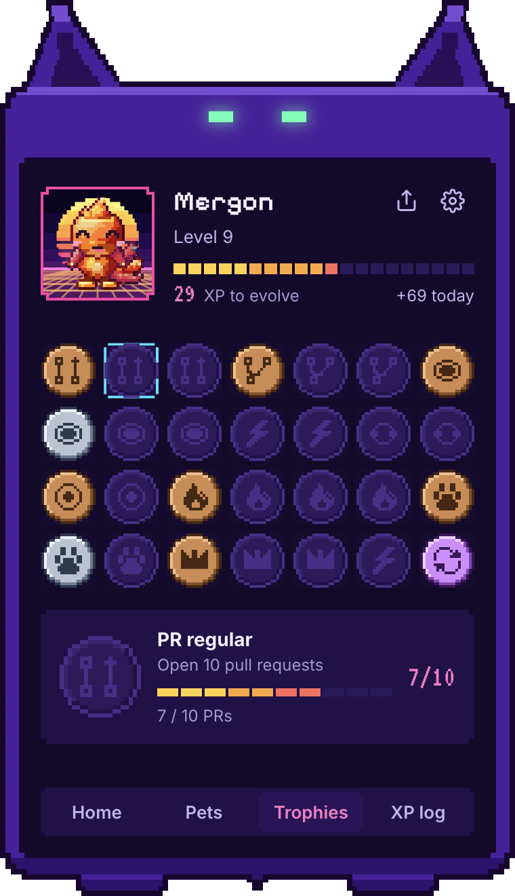
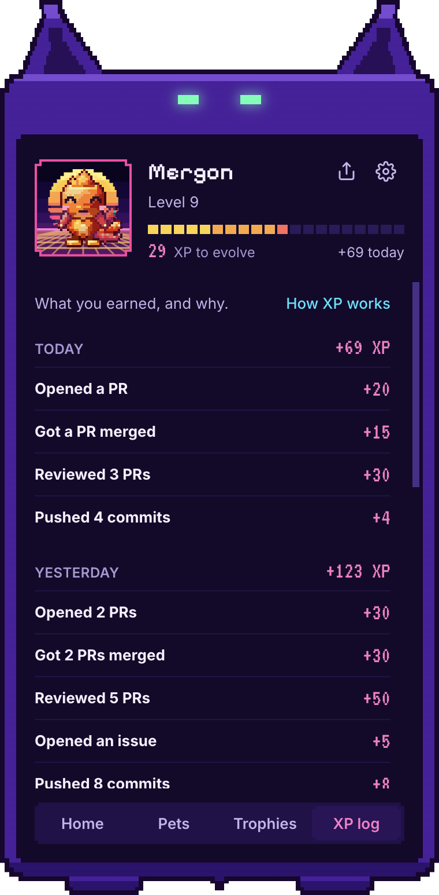
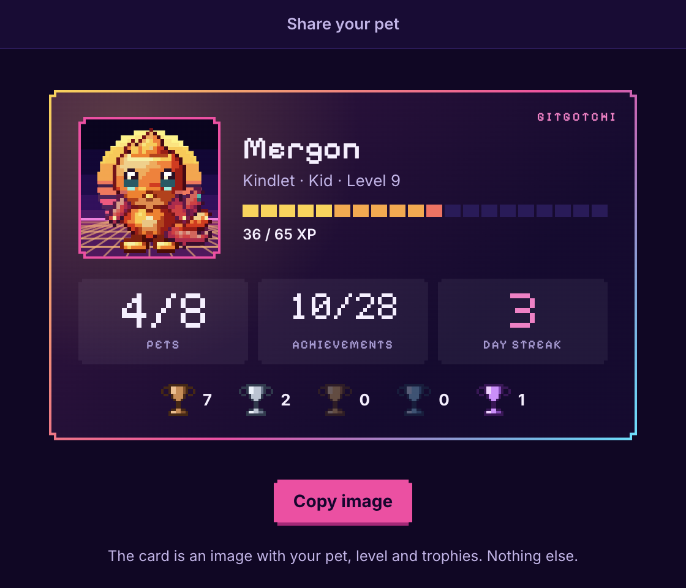
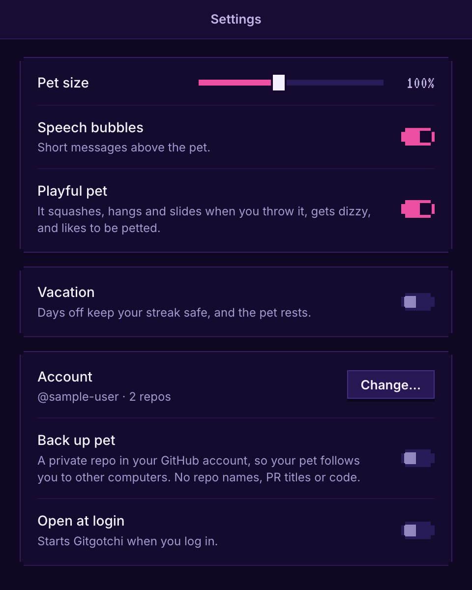
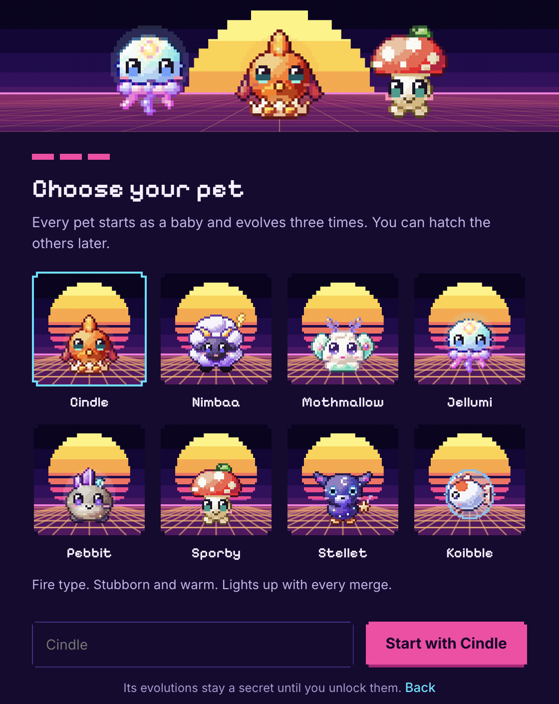

<p align="center">
  
</p>

# Gitgotchi

A pixel art pet that lives on your desktop, floats above every window, and evolves with your GitHub activity (private repos included).

- **A pet on your desktop.** It idles, strolls, cheers when a PR of yours is merged and reacts to your PRs. Drag it, throw it, pet it.
- **It grows with your work.** PRs, reviews, merges, issues and commits earn XP. Every pet goes through four stages: Baby → Kid → Young → Adult.
- **A collection to fill.** Eight creature lines (one pet per species) and 28 achievements with console-style trophies.
- **Calm by design.** Weekends never break your streak, a vacation mode pauses everything, and the pet is never anxious: no queues, no reminders, no notifications.
- **Private.** It reuses your `gh` login (no tokens stored), only looks at the repos you pick and never reads your code.

## Take a look

### The pet

<table>
  <tr>
    <td width="200" align="center" valign="middle">
      
    </td>
    <td valign="middle">
      Drag it anywhere and click it to open its card. It says a short line when something happens (a merge, an approval, a level up, a trophy) and it answers the hand: it squashes when you press it, hangs when you pick it up and slides when you throw it. See <a href="#playing-with-it">Playing with it</a>.
    </td>
  </tr>
</table>

### The card

Click the pet (or the menu bar icon) and its card opens, with four tabs.

<table>
  <tr>
    <td align="center" valign="top" width="25%">
      <br />
      <b>Home</b><br />
      Growth path, XP this week and your streak
    </td>
    <td align="center" valign="top" width="25%">
      <br />
      <b>Pets</b><br />
      Your collection: switch, hatch or rename
    </td>
    <td align="center" valign="top" width="25%">
      <br />
      <b>Trophies</b><br />
      28 achievements, by tier
    </td>
    <td align="center" valign="top" width="25%">
      <br />
      <b>XP log</b><br />
      What you earned each day, and why
    </td>
  </tr>
</table>

### Share, settings and setup

<table>
  <tr>
    <td align="center" valign="top">
      <br />
      <b>Share card</b><br />
      Copy your pet as an image
    </td>
    <td align="center" valign="top">
      <br />
      <b>Settings</b><br />
      Size, bubbles, play, vacation, backup
    </td>
    <td align="center" valign="top">
      <br />
      <b>Setup</b><br />
      Your account, your repos, your first pet
    </td>
  </tr>
</table>

The pictures use sample data (no real account or repos).

## Setup

Requires the [GitHub CLI](https://cli.github.com) logged in (`gh auth login`). The app reuses that login: nothing to register, no tokens stored.

```sh
npm install
npm run dev   # auto-reloads on changes
```

The first launch walks you through three steps: your GitHub account, the repos that earn XP, and your first pet.

- With several `gh` accounts logged in on github.com, the setup lets you pick one. Its token is used via `gh auth token --user`, and gh's active account is never switched.
- Set `GITGOTCHI_GH_PATH` to use a `gh` binary outside the usual locations. Pointing it to `/usr/bin/false` simulates being logged out.

## Using it

- **Drag** the pet anywhere. **Click** it to open the card.
- The **menu bar icon** (a click or a right-click) and a right-click on the pet open the menu: _Vacation…_, _Hide pet_, _Pet card_ (the card, also when the pet is hidden), _Settings…_ and _Quit_.
- In the card, the **share** icon opens a small window with your pet's card to copy as an image, and the **gear** opens Settings. Neither closes the card.

### Playing with it

_Settings → Playful pet_, on by default.

- It **squashes** when you press it, **boings** when you click, and looks up at the card while it is open.
- **Pick it up** and it hangs from the spot you grabbed, arms up, and swings with the cursor. Grab it by its feet (the lowest quarter of the body) and it turns upside down, with the body below the cursor.
- **Let it go** and it falls and lands in a puff of dust. The ones that float, like the koi or the jellyfish, have none: they only squash.
- **Throw it** and it slides on, further the harder you threw it, over to another screen if you aim for one, bouncing off the walls and the top of the screen and landing on the bottom.
- **Swing it hard** or turn it over a couple of times and it gets dizzy. **Stroke it** back and forth with the mouse and it enjoys it.

With the setting off it is a pet you can drag and nothing else. It also holds still under Reduce Motion and on a vacation.

## How it works

**Source:** your GitHub activity (private repos included), only for the repos you pick: PRs (GraphQL), reviews, issues and pushes (Events API). XP syncs every 90 s. GitHub only returns your latest 300 events, so the app keeps its own per-day history.

### XP

| Activity     | XP                                                    |
| ------------ | ----------------------------------------------------- |
| PR opened    | 5–30 by size                                          |
| Review       | 10 (+5 more when it answers a request within an hour) |
| PR merged    | +15                                                   |
| Issue opened | 5                                                     |
| Commit       | 1 (up to 10 XP a day)                                 |

- Commits are counted per push, only yours (no merge commits), with one extra GitHub request per push.
- A review is _fast_ when it comes within an hour of the date you were asked (see _Review requests_ below). The app remembers the requests it saw until you review them, so a review of a request it never saw is a normal one.
- XP rules and thresholds live in `src/main/game/catalog.js`.

### Level and stage

Levels come from the XP a pet has earned and scale with your own weekly baseline. A pet never goes down a level or a stage.

| Stage | From level |
| ----- | ---------- |
| Baby  | 1          |
| Kid   | 5          |
| Young | 10         |
| Adult | 18         |

Every level up gets a pill over the pet (_Level 10_), the XP that arrives floats up as _+10 XP_, and every evolution gets a celebration window (the picture at the top is from one).

### Collection

You keep every pet you hatch, one per species (eight lines to collect: Cindle, Nimbaa, Mothmallow, Jellumi, Pebbit, Sporby, Stellet and Koibble, each with three evolutions that stay a secret until you unlock them), and raise one at a time: only the **active** pet earns XP.

- Switching is free and nothing is lost: a pet that waits keeps its XP, level and stage.
- New XP goes to whichever pet is active when the app sees it (to the active pet if the app was closed). Changing repos never takes XP away from a pet, and it cannot be farmed.
- Each pet keeps its XP per day, so two computers merge them with a max per day.
- The _Pets_ tab is a grid: a card per species (the silhouette of the ones you have not hatched) and, under it, what you can do with the selected one: _Switch to …_, _Hatch …_ (with a name) and a pencil to rename. When you switch or hatch, the new pet grows out of a flash on the desktop and says that it earns the XP now.
- A pet that reaches the last stage is fully grown (a gold frame and a trophy) and keeps leveling if you leave it active. Hatching all eight and growing them all up is the goal after level 18.

### Mood

Two states: **happy** (a PR merged in the last 48 h, or a strong week) and **neutral** (everything else). The pet is never anxious: a PR that waits for review does not change how it feels. The mood shows in the card (the portrait plays a happy pose and the eyes of its shell turn mint), not on the desktop pet.

### Streak

Days in a row with activity, since the first pet hatched. Weekends never break it: a Saturday or Sunday without activity is skipped, one with activity counts. Days of time off (see below) are skipped too. Missing any other weekday starts over.

### Vacation

The one way to say "leave me alone for a while". Start it from the menu (_Vacation…_) or _Settings → Vacation_, and pick the day you are back in _Settings_ (without a date it lasts until you say _I'm back_).

- Your streak is safe: those days are skipped, like weekends.
- The dates travel with the cloud backup.
- Nothing talks to you (no speech bubbles or evolution popups) and the pet only idles.
- While it lasts, the card says so and offers _I'm back_.

### Achievements

28 of them: first PR, 10 and 50 merges, 100 reviews, a review within an hour of being asked, a 5-day streak, a PR merged within an hour, hatching 2, 4 or all the pets, growing them up…

- They are yours, not a pet's: counted from the day your first pet hatched, so what happened before it does not count, and they stay when you switch pets.
- Like console trophies, each has a tier (bronze, silver, gold, diamond, or special) that is only the color of its medal: there are no points and no score.
- The _Trophies_ tab is a grid of pixel medals in the color of their tier (dim while locked) and, under it, the selected one with how far you are. It opens on the one closest to unlock.
- Reaching one is recorded and never lost, travels with the cloud backup, and the pet celebrates it once.
- The list and tiers live in `src/main/game/catalog.js`.

### Share card

The share button of the card (next to the gear) opens a small window with a card with your pet, its level, your pets, achievements, streak and the trophies of each tier, and copies it to the clipboard as an image to paste anywhere. It has nothing else on it: no repos, no PR titles, no username. It only reads the pixels of that window and writes to the local clipboard; nothing is sent.

### Review requests

The app asks GitHub which open PRs ask for your review (directly or through one of your teams) only to remember _when_ you were asked, so that a review within an hour of the request earns its bonus. It shows no queue, no reminders and no notifications: the app is about the pet and your XP, not a to-do list.

### Live reactions

- A `git push` from a local clone of a selected repo is detected instantly (the app watches the clones' reflogs).
- Your PRs are checked every ~10 s (60 s when idle), so a merge celebrates within seconds.
- The pet also reacts, with a wiggle and a line, when your own PR gets changes requested, its checks fail, it gets merge conflicts, or it becomes ready to merge (no XP for those).
- A PR with conflicts shows _Merge conflicts_ in the card, ahead of failing checks, and is never _Ready to merge_.

## Settings

_Settings…_ in the menu:

- Pet size, speech bubbles and playful pet.
- Vacation.
- The account and repos (_Change…_ reopens the setup: two steps when you already have pets, since pets are managed in the collection).
- _Back up pet to GitHub_.
- _Open at login_ (on by default; on macOS it installs a LaunchAgent in `~/Library/LaunchAgents/com.gitgotchi.app.plist`).

## Backup

Optional, off by default. _Back up pet to GitHub_ keeps a private repo `<you>/gitgotchi-save` in your own GitHub account with one file, `save.json`:

- your pets (name, species, birth date, level, stage and the XP each earned per day) and which one is active,
- your achievements and the XP counts per day and kind,
- which repos you picked **as ids** (a hash of your account and the repo name).

It has no repo names, PR titles or code. The ids keep the names from being read at a glance; they are not encryption, so whoever can guess a name can check it.

- **Restore:** on another computer, the setup offers to restore the save (with all your pets) and finds your repos again among the ones you can see. One that you can no longer see, or that is not among your 300 most recently pushed, is left out: pick it again.
- **Turning it off** stops syncing but leaves the repo. Delete it on GitHub to remove it (the app cannot delete repos).
- **Old saves:** saves written before the ids existed had the repo names, and they stay in the repo's history. Delete the repo and turn the backup on again to get rid of them.
- **Compatibility:** saves from before the collection (one pet) are still read. Two computers keep both collections (a species on only one of them is never lost), so update the app on all of them: an older version cannot read the new file.

## Development

### Structure

```
src/
  main/                     main process (Node)
    main.js                 app lifecycle and wiring
    config.js               constants
    store.js                local JSON state
    ipc.js                  IPC contract (mirrors preload.js)
    github/gh-cli.js        token from the `gh` CLI
    github/client.js        GitHub REST API
    game/catalog.js         species, stages, scoring
    game/engine.js          pure game rules (no I/O)
    game/collection.js      the pets, their XP per day, the collection view (pure)
    game/achievements.js    achievement progress (pure)
    services/session.js     GitHub connection via `gh`
    services/pet-service.js sync, setup and pet events
    ui/                     windows and tray
  preload/preload.js        safe API exposed to pages
  renderer/
    shared/                 synthwave tokens and components, DOM helpers, sprites, pet animation (pet-animator.js is the pack's player)
    pet/                    floating pet window
    popover/                the card: header and four tabs, Home, Pets, Trophies and XP log (one module per tab)
    share/                  share window: the card of your pet, to copy as an image
    settings/               preferences window
    onboarding/             onboarding: GitHub, repos and the first pet (one module per step)
```

### Sprites

Eight creature lines with four stages each live in `assets/pets/`: the static rest poses (`<id>_<k>.png`, plus `_happy` and `_anxious`), `sprites.json` (names, sizes and shadow ellipses), and for the animations `sheets/` (14 frames × 3 moods per stage, with the shadow as its own layer; the app never plays the anxious row), `fx/` (hearts, sparkles, sweat drops, dust and each line's ambient particle) and `animations.json` (timings, lift per frame, facing and effect anchors). English copy per line is in `src/main/game/catalog.js`.

The desktop pet is animated by `src/renderer/shared/pet-animator.js`, copied verbatim from the pack's reference player (do not edit it; update it from a newer pack). `pet/pet-view.js` draws it on a canvas at a whole-number scale with nearest-neighbor filtering and decides when it moves: an idle loop with blinks; a short stroll every 20–60 s; a cheer when a PR of yours is merged or approved (or you earn an achievement), followed by a burst of hearts and sparkles for a few seconds and a spell of being happy. Otherwise the pet on the desktop is always in its normal state: how it feels, and why, shows in the card: the portrait plays the mood (a happy pose) and the eyes of its shell show it (cyan, mint when happy, dim on vacation). A happy pet is otherwise quiet: it can stay happy for days, so hearts are a reaction and not a state. On vacation or with macOS _Reduce motion_ the pet only idles. The profile and onboarding use the static poses.

### Scripts

- `npm run dev`: run with live reload (UI changes reload the windows, main process changes restart the app)
- `npm start`: run the app
- `npm run format` / `npm run lint`: Prettier
- `npm run shots [-- share popover panel settings evolution pet] [--tab pets|pets/koi|trophies|xp] [--tall] [--scroll] [--celebrate] [--happy] [--fresh] [--complete] [--click selector]`: renders the windows with sample data (four pets, one fully grown) to PNG files (path printed) and flags cards that overflow. Use it to check a UI change by eye. The pictures in `docs/images/` use the same sample data: take them again after a UI change
- `npm run shots:check [case ...]`: visual tests. Renders the card (and its tabs), the share window, the menu, settings, the setup and the evolution windows (with a fixed clock, no animation and no animated sprites) and compares each with the screenshot saved in `test/visual/`. A window that changed, grew, shrank or overflows fails, and `test/visual/__failures__/` gets the actual and a diff image (changes in red). If the change is on purpose, `npm run shots:update` saves the new screenshots: look at them before committing (the pet window is not covered: it is random and has its own tests). It needs Electron, so CI does not run it, and the references are made on macOS (another system may need its own)
- `npm test`: unit tests (Node built-in runner, files in `test/`)
